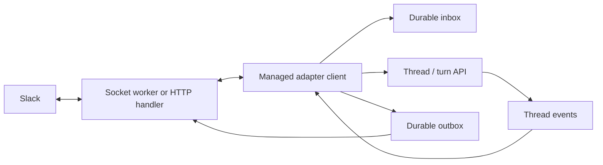

# Managed adapters

Design and implementation notes for replacing the self-agent adapter path. The setup docs live in
[`website/docs-src/adapters/`](../website/docs-src/adapters/index.md). Slack is implemented for local servers. Other transports and hosted deployment are planned.

## Model

An adapter is a client of an agent. It receives input, opens or resumes a thread,
submits a turn, follows its events, and delivers the response to the originating
chat. The same agent can be used from Slack, the terminal, or an HTTP client.

The adapter owns the external connection and delivery. The provider owns the
thread, sandbox, vault selections, and execution. A harness does not need to know
how to send a Slack message.



## Configuration

Inline configuration belongs in the agent definition:

```yaml
adapters:
  - type: slack
    vault: support-slack
    allowed_channels: [C123456]
```

`type` selects a built-in transport. `name` defaults to `type`; two adapters of the
same type need distinct names. Resolve names before checking duplicates. Options
are specific to the type, with snake_case field names and no generic `config` or
`initialization` object. Use a serde enum tagged by `type`, with typed variant
fields and rejection of unknown fields.

Slack requires an explicit `vault` and supports `transport: socket` (the default) and
`transport: http`. Both use `bot-token`; Socket Mode also requires `app-token`,
while HTTP requires `signing-secret`. There is no fallback to `global`.
Slack's `use_sender_vault` defaults to `false`. When enabled, each turn uses
`global` plus the sender's associated private vault, if available. It does not
change conversation routing or grant access to the adapter's own vault.

Slack HTTP is served by the same HTTP server as the managed-agent API, started by
`exo run --serve`. It uses the server's bind address and port. Adapter definitions
do not have `bind` or `path` fields; webhook routes are built in:

| Route                                        | Server scope                     |
| -------------------------------------------- | -------------------------------- |
| `POST /exo/adapter/ADAPTER_NAME`             | Explicitly selected agent        |
| `POST /exo/agent/AGENT/adapter/ADAPTER_NAME` | Whole provider or selected agent |

`AGENT` resolves a slug or ID; `ADAPTER_NAME` is the resolved name from the agent
definition. A single-agent server's default Slack adapter uses `/exo/adapter/slack`.
Print the webhook URL at startup. Events, URL challenges, and interactions use the
same route. For a local HTTP deployment, publish only this callback path over
HTTPS. The unauthenticated local API trusts loopback connections: a tunnel or proxy
to the whole port would expose API operations as well. Keep its other paths private,
or configure `--auth-file` when publishing the API. The callback uses Slack
authentication; all other routes retain the server's normal API authentication.
Do not trust forwarded headers to make an unauthenticated API public.

HTTP deployment starts in `awaiting_credentials` when its vault is empty, without
stopping the server. During provisioning, its declared callback can answer only
URL-verification challenges by echoing the supplied challenge; this does not admit
input, resolve a user, read vaults, or execute a turn. Accept events and interactions
only after the credentials and app/workspace identity have been validated. This
allows starting the endpoint before creating the Slack app from an HTTP manifest.
Credential changes activate the deployment without restarting the server.

## Hosted providers

Braintrust and Cloudflare providers require `transport: http`; reject the default
Socket Mode configuration on those providers with an actionable error. Socket Mode
requires a supervised long-lived connection and remains available to the local
provider. Do not silently select another transport.

A hosted provider owns its callback endpoint. For provider base URL `BASE`, the URL
is `BASE/agent/AGENT/adapter/ADAPTER_NAME`; the base includes any provider prefix,
e.g. `/exo`. Agent creation returns the deployment's full webhook URL. No local
`--serve` process, reverse proxy, or tunnel is needed for hosted execution.

Create the adapter vault and import its secrets on that provider with `--provider`,
then create/update the agent there. A local vault is not uploaded with the agent
definition. Hosted provisioning uses the same `awaiting_credentials` state and
challenge-only behavior, so the returned URL can go in the Slack manifest before
the app's credentials are imported. HTTP handlers use durable provider storage and
execution queues; they do not require a Node sidecar or a persistent process in a
Worker. Both transports use the same normalized managed input/output flow.

## Deployments

Start local adapters with `exo run support-analyst.md --serve`. Serving a single agent
starts only its adapters; whole-provider serving starts the authorized deployments
in its scope. A saved agent definition expresses desired configuration, while
connection state and pairing profiles belong to its deployment on the provider.

Reconcile on startup and agent updates. Keep deployment identity for the same
`(agent_id, resolved_name)`, restart a worker when its effective configuration or
credentials change, and stop it when removed. Removing an adapter preserves its
threads and delivery records. Changing external accounts starts a new account
namespace so old conversations cannot acquire another account's context.

## Credentials

Resolve adapter credentials using the deployment owner's access to the explicitly
named vault. Do not resolve them through a thread's attached vaults. Reject missing
secrets before connecting, with a useful setup error. A token refresh or replacement
should reconnect without requiring an agent-definition change.

The Slack connection runs on the provider's host. Bot credentials are never mounted
into agent sandboxes or included in the sender's execution context.

## Identity

The deployment owner's authority is used to maintain the bot connection. Agent
access and private credential access are independent. Authenticate each sender
using Slack's event fields and apply the adapter's user/channel policies. An allowed
sender without resolved private access runs in a restricted shared-only context
with `global`; no personal vault is required or inherited from the operator.
That context may execute this deployment and use its shared resources, without
granting access to arbitrary provider agents, accounts, vaults, or threads.

Assign a private vault to a shared user identity once, using email as the
administrator-facing selector:

```bash
exo vault bind alice --email alice@example.com
```

Resolve or provision the canonical identity through the provider's identity store
and save its stable account ID as the vault owner/default private-vault association.
Use the existing account-to-vault ownership mechanism. Email is an identity lookup,
not the persistent ownership key. The association applies across adapters and
agents on that provider, subject to normal execution and credential permissions.

Adapters resolve authenticated senders to that same identity. An exact, unique
email claim from a provider-configured trusted identity source can select the
account automatically. The administrator assigns the vault once and configures
trusted identity sources once; there is no required per-user/per-adapter mapping.
Missing or ambiguous identity resolution leaves an otherwise allowed sender in
shared-only execution. Never use an email supplied in message text or a display name.

For Slack, automatic email resolution requires trusting the specific workspace's
directory as an identity authority and looking up the authenticated sender there,
using `users:read` and `users:read.email`. Slack profile email is not a standalone
verified-email proof. Trusting an Enterprise Grid workspace includes members of
the entire Grid organization, verified against the installation's enterprise ID.
Only accept directory claims within that configured trust
scope; guest and external Slack Connect profiles are not automatically authoritative
for private vault ownership. Verified SSO claims can provide the same resolution.
Other adapters that don't provide a trusted common identity may need an account
link, but the vault association remains the same.

An administrator may optionally pin `(slack_workspace_id, slack_user_id)` to an
account for stricter control. Pins take precedence over email resolution and apply
provider-wide to that Slack identity, across deployments. An invalid existing pin
must not resolve the user to a different private account through email. Explicitly
removing a pin restores the provider's configured identity resolution; revoking
vault access blocks private use regardless of the resolution method.
Keep explicit pin create/list/delete operations available, with this command shape:

```bash
exo identity list
exo identity trust slack --workspace T123456
exo identity untrust slack --workspace T123456
exo identity bind slack --workspace T123456 --user U123456 --account ankur@example.com
exo identity unbind slack --workspace T123456 --user U123456
```

`identity list` supplies provider account IDs, including the standalone local
account. `--account` accepts an account ID or an exact, unique account email; an
ambiguous email must fail rather than select an account. `--provider` selects where
vault associations, identity sources, and optional pins are stored. Resolve pins using the
app's installation workspace and authenticated sender user ID, including when
explicitly allowing Slack Connect. Identity/ownership changes must be audited and must not
grant access to an account's vaults beyond its existing authorization.

Authenticated servers bind to existing admitted accounts; standalone local
setup can associate a vault with a user identity or explicitly pin the operator's Slack account.
Do not implicitly treat other Slack users as the local operator. Shared-only
execution uses the adapter's explicit admission policy; resolved-account execution also checks
the resolved account's admission, execution permissions, and vault access.
Granting access to this deployment must not enable global multiplayer access to
everyone's threads. Revoking identity resolution or the vault association removes
private credential access for future turns. The user can continue the same
conversation with shared credentials if the adapter's access policy permits it.
Previously fetched data remains in that conversation; revocation does not erase it.
Pending turns and approvals cannot resume under a different authorization context.
Queued inputs are reauthorized before execution.

### Vault selection per turn

The adapter's `vault` selects bot connection credentials. `turn_vaults` selects
shared vaults available while answering a message. `use_sender_vault` adds the
sender's private credentials:

```yaml
adapters:
  - type: slack
    vault: support-slack
    turn_vaults: [sre]
    use_sender_vault: true
```

The default, `false`, uses `global` and the configured `turn_vaults`, without
looking up a private user identity. With `true`, a resolved sender also uses their default private vault
(`personal`) for that turn, taking precedence over `global`. A sender without an
associated vault still uses `global`. Never attach one sender's private vault to
the persistent thread or accumulate participants' vaults.

Select and authorize the vault before running tools or materializing resources
that require credentials. Apply the same selection to model calls, MCP clients,
custom tools, and sandbox egress. When a caller changes, replace authenticated
clients and credential bindings under the per-thread turn queue, after the
previous turn finishes. Stop prior caller processes and revoke their credential
capabilities before the next turn starts. Do not use reopening or input admission
to change a running turn's credentials. The shared filesystem and history remain.

Keep shared model keys in `global`; personal GitHub/MCP credentials belong in the
user's vault. Review `global` before enabling the adapter: every usable secret in
it is available to everyone the adapter admits. Log the names and destination
policies of reachable shared secrets at deployment startup, never their values.
Neither mode inherits the operator's private credentials or the bot's vault.
A missing private credential does not prevent shared capabilities from working:
omit MCP tools that require unavailable authentication, and report missing
credentials for operations or required resources that need them. The model's
configured credential must still be available, normally from `global`.

Apply `allowed_users` independently of private identity/vault resolution, along with
channel/DM filters. Omitting it admits eligible Slack users; `[]` admits none. Slack Connect channels
are rejected by default (`allow_slack_connect: false`). Opting in requires explicit
channel IDs in `allowed_channels`, and every sender still needs adapter access.
Private credential access additionally requires trusted identity resolution and authorized vault ownership. Check Slack's shared-channel metadata before admission and fail
closed if its status cannot be determined. Subscribe to `channel_shared` and
`channel_unshared` to invalidate cached status; use `conversations.info` when needed.
External users and guests get no implicit operator privileges.

Other transports must also authenticate and resolve senders before using private
vaults. Unauthenticated IRC nicknames cannot identify a private credential owner.

### Storage

Vault ownership, canonical identities, trusted identity-source policies, and
optional external-ID pins belong to the execution provider's identity/access-control
store. Persist email/verified aliases on the account, vault ownership/defaults by
account ID, and optional pins by source/workspace/user ID. Include version/audit
metadata so authorization can be rechecked. Credentials remain in their vaults.

The current local authenticated server persists accounts and vault ownership in
`exo-server-state`, encrypted in a protected server vault, in
`crates/executor/src/native/remote/store.rs`. Extend/refactor that provider-owned
store for common identity resolution and standalone local identity rather than adding a second
adapter-owned account database. Local state remains under the selected Exo root
(`~/.exo` by default); standalone adapters must not require configuring OIDC just
to use shared credentials. Hosted providers persist the same associations in their
identity store. Associations are scoped to a provider and are maintained through its
admin API/CLI, with no agent-frontmatter or worker-state copy.

## Conversations

For Slack, persist a mapping from `(deployment_id, external_account, conversation_key)` to
`(agent_id, thread_id)`. Creating this mapping must be atomic or use deterministic
thread identity so concurrent first messages cannot create two threads.
One Slack conversation has one Exo thread, including when several people
participate. Each turn records its author and vault selection independently.
Changing the sender or their vault association does not create a new thread or
discard history.

History, artifacts, and filesystem state are shared within that conversation.
`use_sender_vault: true` scopes new authenticated requests to the current sender;
it does not isolate data already fetched. For example, if Alice checks out a
private repository, Bob's next turn can read that checkout but cannot make new
requests with Alice's token. Document this sharing explicitly. Operators who need
shared credentials only can leave `use_sender_vault` disabled. Replies go to the
originating Slack conversation, where participants can read them.

| Transport     | Conversation key                                                       | Reply destination       |
| ------------- | ---------------------------------------------------------------------- | ----------------------- |
| Slack channel | Workspace, channel, root message timestamp                             | Same Slack thread       |
| Slack DM      | Workspace, DM channel; add root timestamp for an explicit reply thread | Same DM or reply thread |
| Discord       | Account, channel ID (including DM and Discord thread channel IDs)      | Same channel            |
| WhatsApp      | Linked account, chat ID                                                | Same chat               |
| Signal        | Linked account, sender or group ID                                     | Same conversation       |
| IRC           | Network, channel                                                       | Same channel            |

Slack `mentions_only` starts work for a channel mention, accepts follow-ups in an
already participating Slack thread, and accepts DMs. A channel allowlist applies
to channel messages, including their replies; `direct_messages` separately controls
DMs. Ignore bot messages, message edits, and delivery echoes in the first version.
Do not fetch unrelated channel history to construct the agent's context. The
`message.channels` subscription nevertheless delivers messages in public channels
the bot has joined to the server; filters decide which of these become turns.

Discord defaults to mentions in server channels and messages in DMs. Channel
messages share an Exo thread; a Discord thread has its own channel ID and its own
Exo thread. WhatsApp and Signal default to direct messages, with groups enabled
through `trigger: all_messages`. IRC defaults to nick mentions in its configured
channel. Check filters before creating a thread or admitting input.

## Input

Transport workers or HTTP handlers normalize messages into a typed envelope: external account,
message ID, conversation key, reply destination, sender, timestamp, and content.
Keep provider-specific payload parsing in each worker. Routing information remains
host-owned; it is not a model-supplied destination.

Verify the transport, identify the sender and execution context, and apply authorization and message
filters before persisting runnable input. Do not store filtered channel traffic in
the execution inbox. Persist the shared-only or resolved-account context and its authorization
version with the input. Recheck access when admitting/replaying a turn. Reject
queued private input if its identity/vault grant was removed or reassigned; never run it under
another account or downgrade it to shared-only execution. Queued shared-only input
may continue with shared credentials if still allowed, but linking must not
promote that input into private credential access.

1. Persist the accepted envelope in the inbox with a stable idempotency key scoped
   to the deployment, account, and provider message ID.
2. Acknowledge external receipt after persistence. Acknowledge Socket Mode envelopes
   and HTTP events/interactions within Slack's deadline; do not wait for the model.
   Socket Mode acknowledges through its SDK; HTTP returns its acknowledgement directly. Handle HTTP
   URL-verification challenges without admitting turns.
3. Resolve the mapped thread and submit through the managed turn queue using that
   idempotency key and resolved caller context. Persist the returned thread/session/turn
   receipt, caller identity, source message ID, and source author.
4. Observe the turn independently of the connection's receive loop.

Replay inbox entries without a receipt after a crash. Turn admission must return the
same turn on a retry; a deduplication marker written before admission is insufficient.
Use the same durable queue as HTTP and terminal clients, so messages in one thread
remain ordered while separate threads can execute independently.

Slack can deliver both `app_mention` and `message` callbacks for one message. Dedup
on workspace/channel/message timestamp, rather than callback envelope ID alone.
Transport acknowledgements confirm durable acceptance, not successful execution.

For HTTP, verify Slack signatures over the original request body and reject stale
timestamps before accepting events or interactions, following Slack's
[request verification](https://docs.slack.dev/authentication/verifying-requests-from-slack/).
The webhook authenticates with the selected deployment's Slack signing secret,
rather than an Exo bearer token; retain normal API authentication on other routes.
Reject requests for adapters outside the server's scope or with a different
transport, and validate the app/workspace identity before admission. Both
transports enforce the same message filters and approval ownership.

Rejected identities or filters never cause model execution. After an authorized
message is durably admitted, queue a best-effort `eyes` reaction (`reactions:write`)
as a receipt. Deduplicate it using the inbound message ID. A failed reaction does
not reject or rerun the accepted turn, and the reaction does not mean the turn
completed successfully.

## Output

Submit the input to the runtime and render its execution stream, just like the CLI.
That stream supplies setup status, assistant text, tools, approvals, committed
messages, and completion. Normalize these semantics across Codex, Claude Code,
and Pi at the runtime boundary; do not interpret a harness's private SDK objects
in the adapter or query its event history to recover an answer.

Queue approvals with deterministic IDs. Commit streaming output, its renderer state,
and its observer cursor together in the same outbox object. Restore that receipt
before reconnecting if the separate inbox save was interrupted.
The runtime resumes a disconnected stream from its saved checkpoint. Resuming
must neither rerun a completed turn nor enqueue its answer twice. Split long
answers using each transport's limits and formatting rules.

Back off transient observer failures without abandoning a recoverable turn.
Malformed progress data stops automatic observation after five failures without
cursor advancement. Close the Slack stream with an "Updates unavailable" error
and log the thread, turn, and decoding error for the operator. This is a delivery
failure, not a failed turn: preserve the underlying turn and conversation. The
operator must investigate the saved event; a later message continues the same
conversation, but the stopped delivery is not automatically retried.

The outbox owns delivery retries, rate limits, and external message IDs. External
delivery is at least once where the provider offers no idempotent send: a crash
after a successful send but before recording its acknowledgement can duplicate a
message. Record delivery failures and show them in server logs. A failed or
cancelled turn gets a short status response, not a fabricated successful answer.

Slack uses one native streaming reply per turn. Assistant text deltas append to
that reply; tool calls, results, and waits update task cards in the same reply.
The outbox records its Slack message ID, buffers updates, and closes the stream
when the runtime reports completion. After a restart, the adapter asks the runtime
to resume the stream and keeps using that Slack message ID. Live and recovered
events go through the same renderer; history replay belongs to the runtime.

## Interactive turns

Approvals remain runtime approvals. Slack buttons identify the pending approval,
turn, and session; only the author of the source message that started that turn can
respond in the first version. Validate the deployment, account, destination, actor,
current execution context/authorization, and pending request
before forwarding a decision. Repeated button clicks must be idempotent. Never
treat a chat message saying "yes" as an approval or silently approve a tool.

Client tool calls need an implementation in the adapter client, just as they do
in any HTTP client. The initial built-in adapters do not implement arbitrary client
tools. Report an unsupported interaction through the existing tool failure path,
rather than leaving the turn waiting indefinitely. Other transports need an
explicit approval interaction before agents requiring approvals can use them.

## Implementation status

Slack's local implementation uses `slack-morphism` for its Web API, signatures, Socket Mode, and Block Kit.
The core is in `crates/executor/src/managed_agents/adapters/`; it submits through the existing turn queue
and persists its inbox, routes, caller authorities, and outbox in provider storage. Identity associations
reuse the protected provider identity store. Other transports remain unported; their TypeScript SDKs
are options for a future bridge. The obsolete self-agent workers have been removed.
Hosted deployment is also still planned.

## Implementation plan

### Performance follow-up

These remain open: completed records accumulate, startup scans their history,
and reconciliation and access checks still enumerate provider metadata.

- Replace the startup scan of historical inbox, outbox, and decision records with
  a durable pending index. Compact completed delivery payloads while preserving
  callback deduplication and turn receipts; do not delete those guarantees to prune
  history.
- Replace periodic agent/artifact/vault enumeration with provider change
  notifications or version lookups. A failed refresh must retain the running
  deployment until a successful read confirms its removal.
- Reduce storage reads in access checks with explicit invalidation for agent,
  vault, and identity changes. Cached access must still reject revoked grants.

### Additional transports

1. Typed inline definitions, deployment reconciliation, bot credential provisioning,
   and adapter admission policies.
2. Slack Socket Mode and HTTP, durable input admission, conversation mapping, and
   final response delivery with shared credentials. Then add shared identities,
   email vault ownership, trusted resolution, optional identity pins, and
   `use_sender_vault` in the same implementation pass. Keep one conversation per
   thread and scope authenticated capabilities to each turn. No change to the
   support agent's instructions is required.
3. Slack approvals, receipt reactions, and restart recovery. Then run the support case through Slack,
   continue the same thread, restart the server, and continue again.
4. Port Discord, WhatsApp, Signal, and IRC onto the same client path. Add rich media
   and progress rendering separately from basic text delivery.

Targeted tests should cover duplicate callbacks and admission retries, concurrent
route creation, recovery between inbox/admission/receipt writes, output replay,
credential isolation, account replacement, allowlists, and approval ownership.
Include allowed unbound users using only shared credentials, denied users,
trusted/untrusted email claims, optional pin precedence/revocation, ownership transitions,
missing private integrations, both `use_sender_vault` modes, shared conversation
continuity across callers, revocation of prior caller credential capabilities,
authenticated API routes versus webhook-only exposure, Slack Connect defaults, and hosted transport
validation/provisioning.
Use existing storage and queue tests where they already exercise those guarantees.
